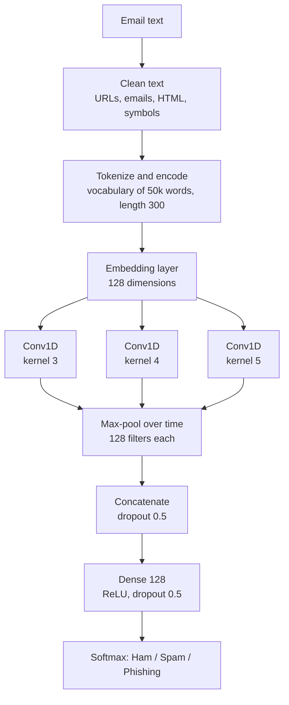
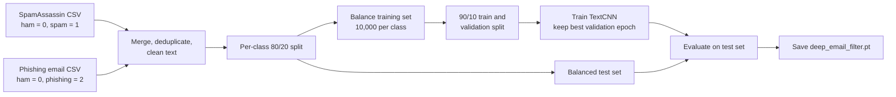

# Email Spam & Phishing Detection (Deep Learning)

A deep learning email classifier built with **PyTorch**. A **TextCNN** model labels each email as **ham (legitimate)**, **spam**, or **phishing**, and returns the probability of each class.


## Overview

| Item | Details |
| --- | --- |
| Task | 3-class text classification (ham / spam / phishing) |
| Model | TextCNN: embeddings, parallel 1D convolutions, max pooling, two dense layers |
| Input | Up to 300 tokens per email, vocabulary of up to 50,000 words |
| Training | Adam optimizer, 8 epochs, best model chosen by validation accuracy |
| Output | Saved checkpoint (`deep_email_filter.pt`) and a command-line predictor |

## Model architecture



## Training pipeline



## Data

| Dataset | Emails | Labels |
| --- | --- | --- |
| SpamAssassin (`SpamAssasin.csv`) | 5,809 | 4,091 ham, 1,718 spam |
| Phishing email dataset (`phishing_email.csv`) | 82,486 | 39,595 ham, 42,891 phishing |

The CSV files are **not included in this repository** because the phishing file is over 100 MB, which exceeds GitHub's file size limit. Download them from their original sources and place them in the project folder:

- SpamAssassin public corpus: `<add link to where you got SpamAssasin.csv>`
- Phishing email dataset: `<add link to where you got phishing_email.csv>`

Expected columns: `SpamAssasin.csv` needs `subject`, `body`, `label`. `phishing_email.csv` needs `text_combined`, `label`.

Training uses a balanced training set (10,000 emails per class, oversampling a class if it has fewer) and a class-balanced held-out test set, so per-class results are easy to compare.

## Getting started

```bash
git clone https://github.com/<your-username>/<repo-name>.git
cd <repo-name>
pip install -r requirements.txt
```

### Predict with the included model

```bash
python predict_deep_email.py --text "Your account has been suspended. Verify your password now."
```

The output shows the cleaned text, the predicted class and the probability of each class. The script uses a GPU automatically if one is available.

### Train from scratch

Place `SpamAssasin.csv` and `phishing_email.csv` in the project folder, then run:

```bash
python deep_email_filter.py
```

Optional arguments: `--epochs`, `--batch_size`, `--max_len`, `--max_vocab_size`, `--max_train_per_class`, `--model_path`.

The script prints per-epoch loss and validation accuracy, then the test accuracy, classification report and confusion matrix, and saves the checkpoint.

## Results

Add your numbers here after training:

| Metric | Value |
| --- | --- |
| Test accuracy | `<fill in>` |
| Ham / Spam / Phishing F1 | `<fill in>` |

## Project structure

```text
├── deep_email_filter.py        # Data prep, TextCNN, training, evaluation, saving
├── predict_deep_email.py       # Command-line prediction with the saved model
├── deep_email_filter.pt        # Trained model, vocabulary and config (~28 MB)
├── requirements.txt
└── .gitignore                  # Excludes the large dataset files
```

## Notes

The `.pt` checkpoint stores the vocabulary and config alongside the weights, and loading it uses `torch.load(..., weights_only=False)`. Only load checkpoints from sources you trust.
